<p align="center">
  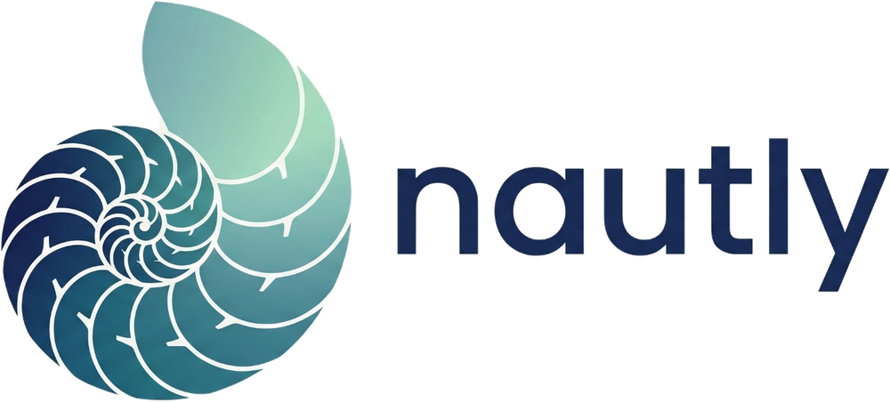
</p>

<h3 align="center">Nautly Agendamentos</h3>

<p align="center">
  Agenda online e gestão de consultórios que se adapta à área de cada profissional.
</p>

<p align="center">
  
  
  
  
  
  
</p>

<p align="center">
  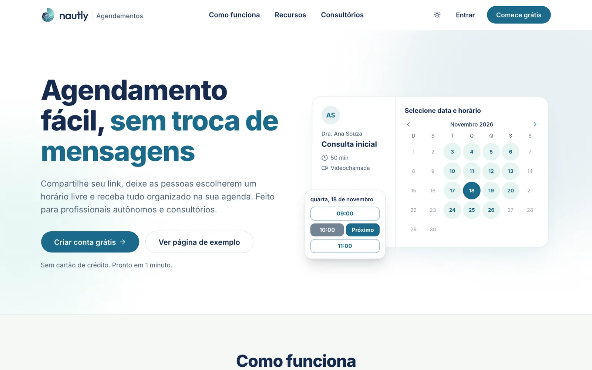
</p>

## A ideia

Quem atende com hora marcada gasta boa parte do dia organizando a agenda, quando poderia estar cuidando das pessoas. No Nautly, o profissional define quando atende e compartilha um link; o paciente escolhe o horário que funciona melhor para ele, a qualquer hora do dia. A conversa entre os dois continua do mesmo jeito. O que sai da rotina é o trabalho de encaixar horários.

Só que, para um consultório, a agenda é só o começo. Uma nutricionista precisa acompanhar o peso do paciente ao longo dos meses, um psicólogo precisa de sessões semanais recorrentes e controle de faltas, um dentista precisa de odontograma e de orçamento aprovado antes de começar o tratamento. Hoje isso vive espalhado entre Google Agenda, planilhas, WhatsApp e papel.

O Nautly junta tudo isso e **se adapta à área de atuação**. No cadastro o profissional escolhe a área, e o sistema ajusta:

- **o vocabulário** ("pacientes" e "consultas" na saúde, "clientes" e "atendimentos" no salão);
- **os tipos de atendimento** já criados;
- **os módulos visíveis**: odontograma só aparece para dentistas, avaliação antropométrica para nutricionistas, e assim por diante.

A tela fica limpa para cada negócio, e o mesmo código atende todos eles. A proposta é ter funcionalidades que justifiquem usar o Nautly no lugar de uma agenda genérica: prontuário criptografado, anamnese respondida pelo paciente antes da consulta, documentos em PDF, orçamentos com aprovação online e registro de acessos para a LGPD.

| Área                    | O que o Nautly oferece além da agenda                                                 |
| ----------------------- | ------------------------------------------------------------------------------------- |
| Psicologia              | Sessões recorrentes, controle de faltas, prontuário com anotações privadas            |
| Nutrição                | Anamnese alimentar, avaliação antropométrica com IMC e gráficos de evolução           |
| Odontologia             | Odontograma, catálogo de procedimentos, orçamento aprovado pelo paciente, receituário |
| Medicina                | Prontuário, anexos de exames, atestado e receituário                                  |
| Fisioterapia e Estética | Planos de tratamento por sessões e procedimentos                                      |
| Salão                   | Agenda e cadastro de clientes, sem módulos clínicos                                   |

## Telas

<table>
  <tr>
    <td width="50%">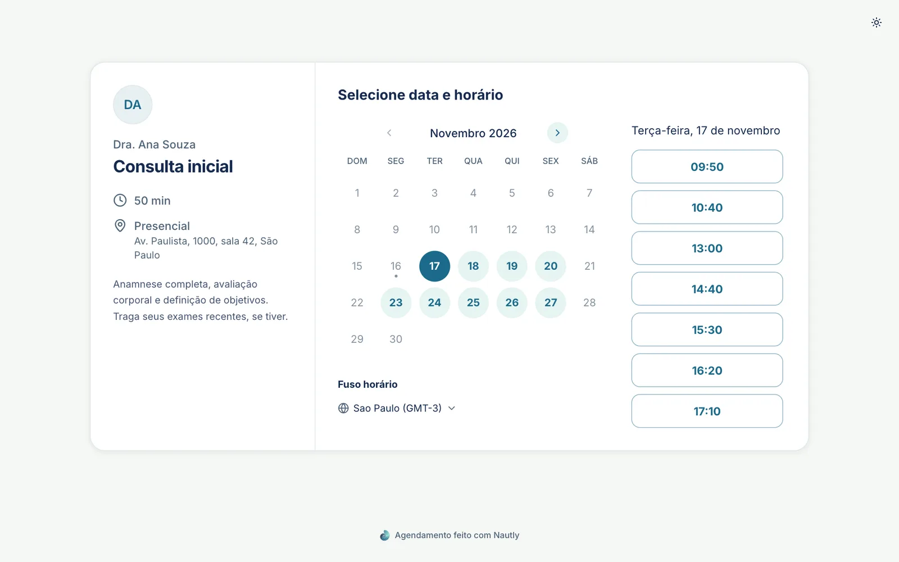<br /><sub><b>Página pública:</b> o paciente escolhe dia e horário, exibidos no fuso dele.</sub></td>
    <td width="50%">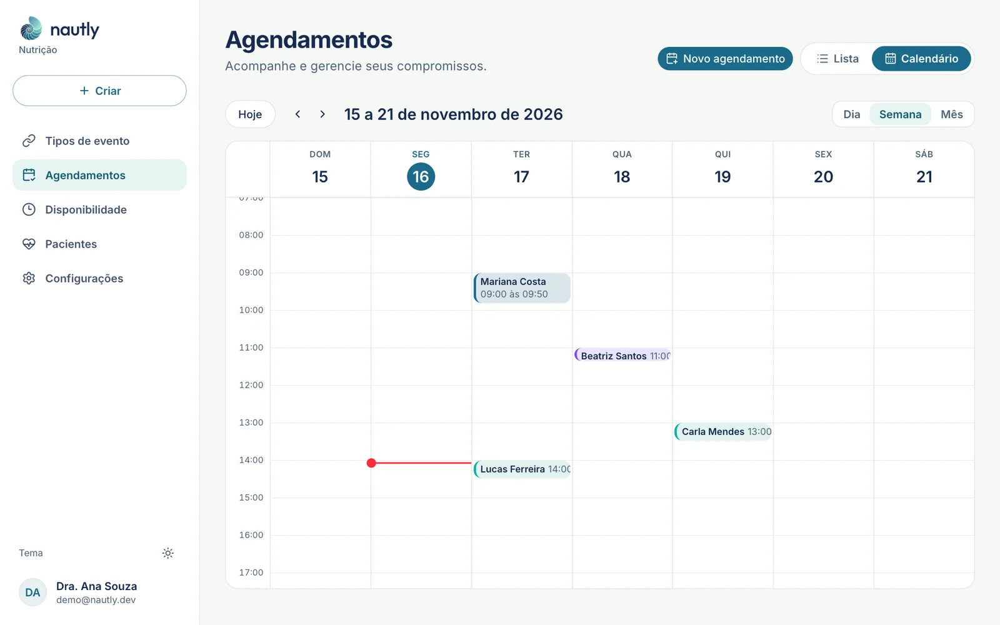<br /><sub><b>Agenda:</b> visões de dia, semana e mês, com encaixes e sessões recorrentes.</sub></td>
  </tr>
  <tr>
    <td>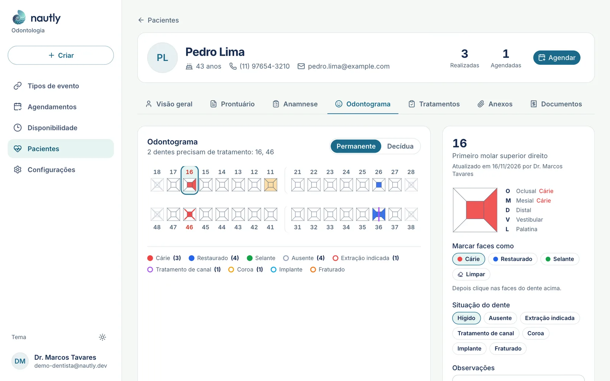<br /><sub><b>Odontograma:</b> cinco faces por dente, dentição permanente e decídua.</sub></td>
    <td>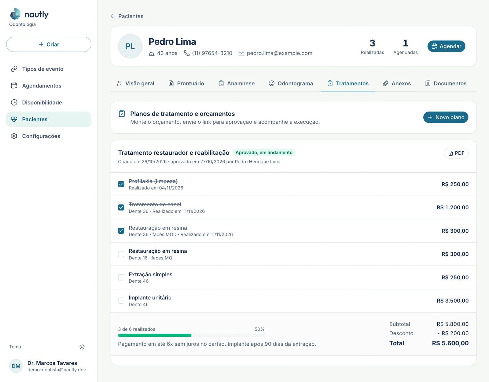<br /><sub><b>Plano de tratamento:</b> concluir um procedimento atualiza o odontograma.</sub></td>
  </tr>
  <tr>
    <td>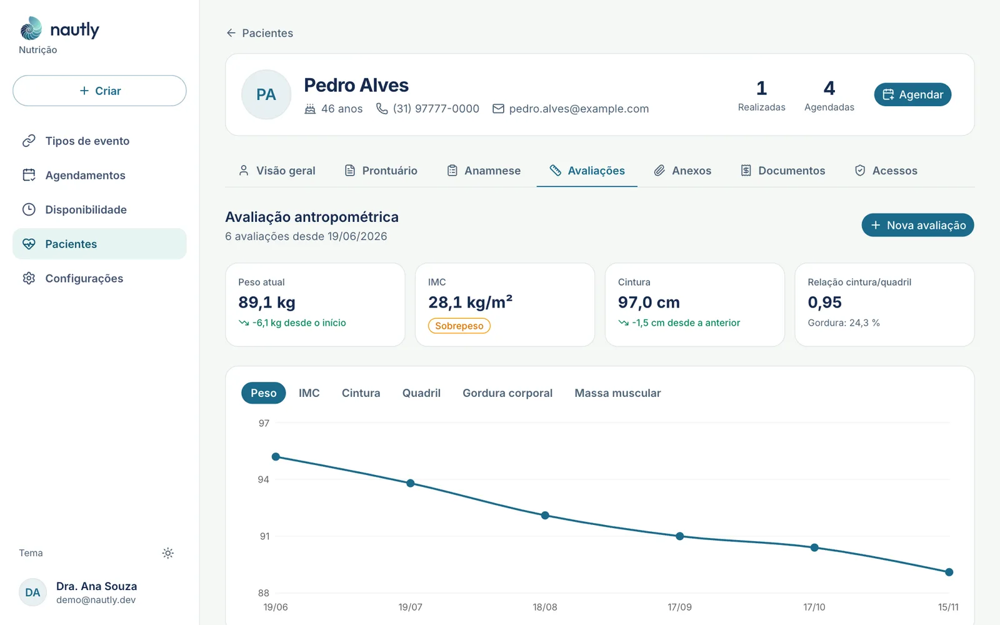<br /><sub><b>Nutrição:</b> evolução de peso, IMC e medidas com gráfico.</sub></td>
    <td>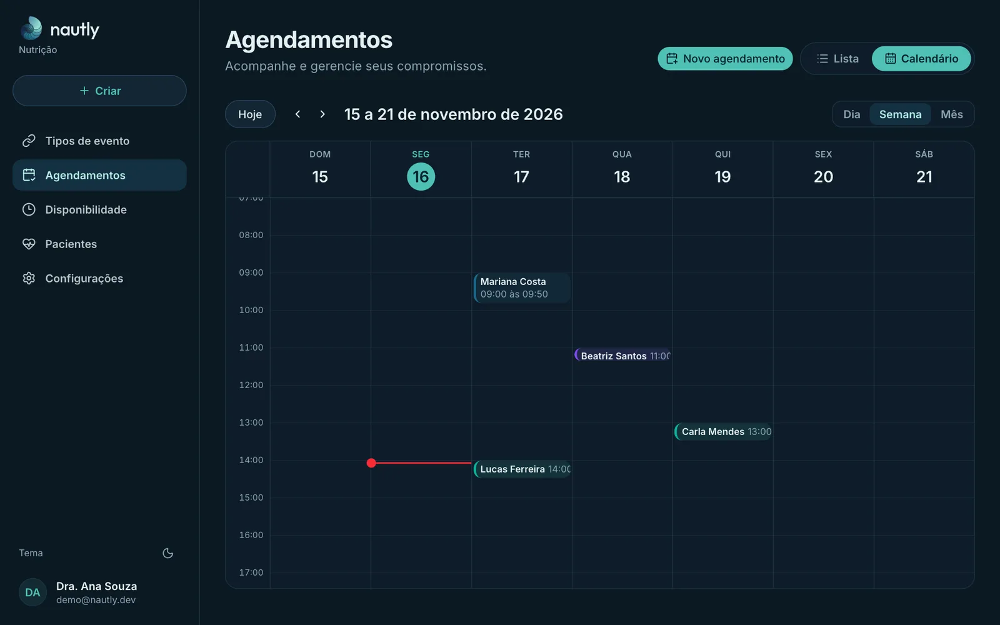<br /><sub><b>Tema escuro</b> em todo o sistema.</sub></td>
  </tr>
</table>

<p align="center">
  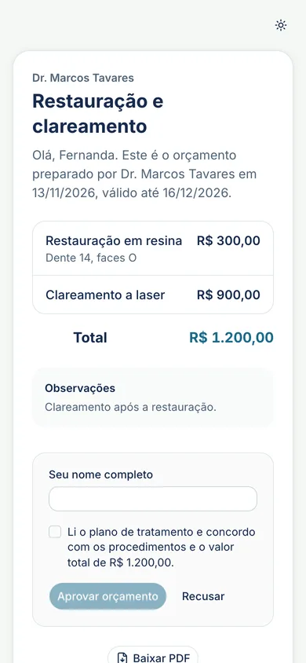
  &nbsp;&nbsp;
  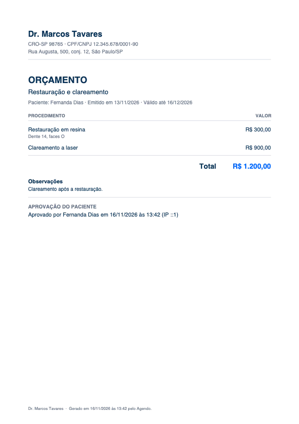
  &nbsp;&nbsp;
  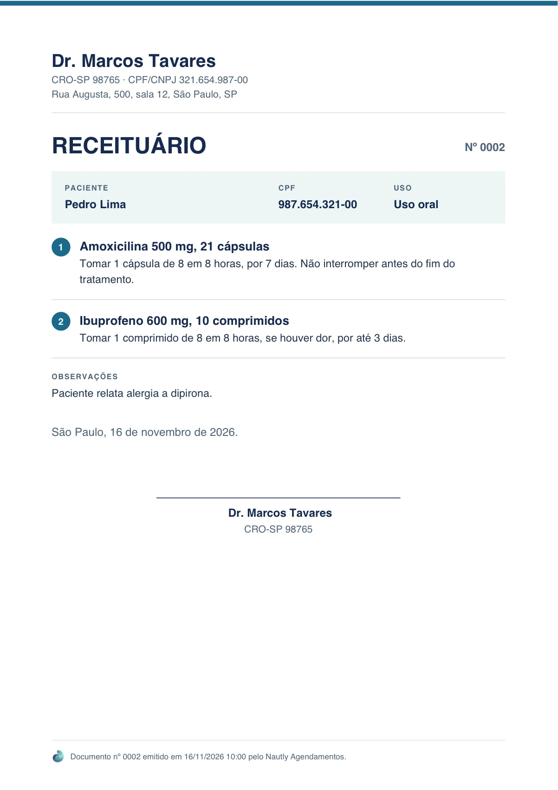
</p>
<p align="center"><sub>O paciente aprova o orçamento pelo celular, e os documentos saem em PDF numerado.</sub></p>

## Funcionalidades

**Especialização por área**

- No cadastro, o profissional escolhe a área (Psicologia, Nutrição, Odontologia, Medicina, Fisioterapia, Salão, Estética ou outra) e se atende sozinho ou em equipe
- Cada área traz vocabulário próprio ("Pacientes" e "Consultas" na saúde, "Clientes" e "Atendimentos" no salão), tipos de evento prontos e o registro profissional (CRP, CRN, CRO, CRM, CREFITO)
- Funcionalidades são módulos que podem ser ligados e desligados em Configurações, então a tela mostra só o que faz sentido para aquele negócio

**Ficha do paciente**

- Dados cadastrais, idade, histórico de consultas e estatísticas
- Prontuário com registros por atendimento, anotações privadas e edição apenas pelo autor (registros não podem ser apagados)
- Anexos (exames, imagens, documentos) com upload por arrastar e soltar, visualização e download
- Anamnese por área (psicologia, nutrição, odontologia, estética ou geral): o paciente recebe o link na confirmação do primeiro agendamento ou por WhatsApp e responde pelo celular, sem conta; o profissional também pode preencher durante a consulta
- Avaliação antropométrica: peso, altura, cintura, quadril, % de gordura e massa muscular, com IMC e classificação da OMS, relação cintura/quadril, variação desde o início e gráfico de evolução por medida
- Recibos para reembolso (com valor por extenso e forma de pagamento) e declarações de comparecimento em PDF, com numeração sequencial por consultório
- Atestado (com dias de afastamento e CID opcional) e receituário simples, disponíveis para Medicina e Odontologia
- Registro de acessos: cada visualização ou alteração de dado sensível fica gravada (LGPD)

**Odontologia e planos de tratamento**

- Odontograma interativo com numeração FDI, dentição permanente e decídua e cinco faces por dente (oclusal/incisal, mesial, distal, vestibular, lingual/palatina): cárie, restauração, selante, ausência, extração indicada, canal, coroa, implante e fratura
- Catálogo de procedimentos com preços, criado automaticamente para a área e editável em Configurações
- Plano de tratamento com itens por dente e face, desconto, validade e condições de pagamento
- O paciente recebe um link (copiar ou WhatsApp), confere o orçamento pelo celular e aprova digitando o nome; ficam registrados data, hora e IP. A aprovação também pode ser registrada no consultório
- Orçamento em PDF, com a aprovação impressa quando houver
- Ao marcar um procedimento como realizado, o odontograma do dente é atualizado na mesma transação (restauração MO troca a cárie dessas faces por restauração, extração marca o dente como ausente) e a barra de progresso do plano avança
- Fisioterapia e Estética usam os mesmos planos, sem odontograma

**Agenda**

- Tipos de evento com duração, local (presencial, vídeo ou telefone), cor, intervalos antes/depois, antecedência mínima e janela máxima
- Disponibilidade semanal com vários intervalos por dia, fuso horário e dias bloqueados (feriados, férias)
- Agendamentos em lista ou em calendário com visões de dia, semana e mês, com atalho para a ficha do paciente
- Agendamento feito pelo profissional (encaixe fora da disponibilidade pública), com repetição semanal ou quinzenal; ocorrências que colidem com outro horário são puladas e informadas
- Controle de presença (compareceu/faltou) e cancelamento de "esta e as próximas" em séries recorrentes
- Tema claro, escuro ou do sistema

**Para quem agenda (páginas públicas)**

- Página pública do profissional (`/ana-souza`) e de cada evento (`/ana-souza/consulta-inicial`)
- Calendário mensal com dias disponíveis, horários exibidos no fuso do convidado
- Confirmação com link para o Google Agenda, download de `.ics` e cancelamento pelo próprio convidado

## Stack

| Camada       | Tecnologia                                                      |
| ------------ | --------------------------------------------------------------- |
| Framework    | Next.js 16 (App Router, Server Components, Server Actions)      |
| UI           | shadcn/ui (Radix), Tailwind CSS v4, lucide-react, next-themes   |
| Banco        | PostgreSQL com Drizzle ORM (PGlite em desenvolvimento)          |
| Autenticação | Better Auth (e-mail/senha + plugin de username)                 |
| Datas        | date-fns + @date-fns/tz                                         |
| Validação    | Zod                                                             |
| Gráficos     | Recharts (componente chart do shadcn/ui)                        |
| PDF          | pdf-lib                                                         |
| Arquivos     | Vercel Blob privado em produção, disco local em desenvolvimento |
| Testes       | node:test via tsx                                               |

## Decisões técnicas

### Áreas, módulos e vocabulário

A especialização não é um "if" espalhado pelo código. Ela tem três peças independentes:

- **Área** ([`verticals.ts`](src/lib/verticals.ts)): define vocabulário, registro profissional, módulos padrão e tipos de evento sugeridos
- **Módulos** ([`modules.ts`](src/lib/modules.ts)): cada funcionalidade (prontuário, anexos, odontograma, pacotes...) declara para quais áreas faz sentido e se lida com dado clínico. A organização guarda a lista de módulos ativos
- **Tamanho** (sozinho ou equipe): ortogonal à área, controla papéis e convites

Assim um consultório de psicologia e uma clínica odontológica rodam o mesmo código, e adicionar uma área nova é só uma entrada de configuração.

### Papéis e permissões

Cada membro da organização tem um papel (`owner`, `admin`, `professional`, `receptionist`) e as permissões ficam em uma tabela única ([`permissions.ts`](src/lib/permissions.ts)). A recepção gerencia agenda e cadastro, mas não lê prontuário; o administrador cuida das configurações sem acesso clínico. Páginas e rotas checam a permissão e, para módulos clínicos, também se o módulo está ativo.

### Dados sensíveis

- Texto do prontuário e arquivos anexados são criptografados com AES-256-GCM antes de ir para o banco ou disco ([`crypto.ts`](src/lib/crypto.ts)), com a chave em `DATA_ENCRYPTION_KEY`
- Downloads passam por uma rota autenticada que valida a organização, registra o acesso e responde com `no-store`
- Upload aceita só PDF e imagens até 4 MB. O armazenamento é uma interface ([`storage.ts`](src/lib/storage.ts)) com dois adaptadores: disco local em desenvolvimento e Vercel Blob privado em produção, ambos guardando o arquivo já criptografado
- Toda leitura de prontuário, criação de registro e acesso a anexo gera uma entrada em `access_log`

### Recorrência no horário local

Uma série "toda terça às 14h" é expandida em [`recurrence.ts`](src/lib/scheduling/recurrence.ts) no relógio local do profissional, então continua às 14h depois de uma mudança de horário de verão (o instante UTC muda, o horário não). A criação usa o mesmo advisory lock das reservas públicas e verifica conflitos dentro da transação.

### Anamnese como modelo versionado no código

Os modelos ficam em [`anamnesis.ts`](src/lib/anamnesis.ts), com campos condicionais ("Quais medicamentos?" só aparece se a resposta anterior for "Sim"). A validação no servidor descarta campos desconhecidos ou ocultos, confere opções e limita tamanhos, porque o formulário público é preenchido sem login: o token de 128 bits é a credencial e deixa de valer após o envio. As respostas são gravadas criptografadas.

### Documentos reproduzíveis

Cada documento (recibo, declaração, atestado, receita) guarda, no momento da emissão, todos os dados que vão no PDF (profissional, paciente, datas, valor). O PDF é gerado sob demanda com pdf-lib, sem navegador headless, e sai idêntico mesmo se o cadastro mudar depois. A numeração usa um advisory lock por organização para não repetir nem pular números.

### Orçamento que atualiza o odontograma

O efeito de cada procedimento no dente é uma função pura ([`dental.ts`](src/lib/dental.ts)) testada sem banco: `applyEffect(estadoAtual, "restoration", ["M", "O"])` devolve o novo estado. Os itens do plano guardam descrição e preço no momento da criação, então mudar o catálogo não altera orçamentos já enviados. O link público só aceita uma resposta: o `UPDATE` exige `status = 'presented'`, então dois cliques simultâneos não geram duas aprovações.

### Motor de horários como função pura

Todo o cálculo de disponibilidade está em [`src/lib/scheduling/slots.ts`](src/lib/scheduling/slots.ts), sem acesso a banco ou rede. Ele recebe regras semanais, exceções por data, agendamentos existentes e configurações do evento, e devolve instantes UTC. Isso permite testar casos difíceis de forma isolada:

- disponibilidade definida em horário local do profissional e exibida no fuso do convidado
- horário de verão (o teste cobre a mudança de 08/03/2026 em Nova York)
- intervalos (buffers) antes e depois, antecedência mínima e bloqueios de dia inteiro

### Sem agendamento duplo

Dois convidados podem clicar no mesmo horário ao mesmo tempo. A criação do agendamento ([`service.ts`](src/lib/scheduling/service.ts)) roda em uma transação que:

1. obtém um `pg_advisory_xact_lock` por profissional, serializando reservas concorrentes
2. recalcula a disponibilidade dentro da transação
3. só então insere o agendamento

Se o horário acabou de ser ocupado, o convidado recebe uma mensagem e o calendário é recarregado.

### Multi-tenant desde o primeiro dia

Todo dado de negócio pertence a uma `organization` (do tipo `personal` ou `clinic`). Todas as consultas do painel filtram por `organization_id`, garantindo o isolamento entre tenants.

```
organization ─┬─ membership ── user ─┬─ schedule ─┬─ availability_rule
              │   (papel)            │            └─ date_override
              ├─ event_type ─────────┘ (host)
              ├─ contact ─┬─ clinical_note   (criptografado)
              │           ├─ attachment      (criptografado)
              │           ├─ anamnesis       (respostas criptografadas)
              │           ├─ measurement
              │           └─ issued_document (recibos, declarações)
              ├─ booking ── event_type, contact, host, booking_series
              └─ access_log
```

### Banco sem setup

Sem `DATABASE_URL`, o app usa [PGlite](https://pglite.dev) (Postgres compilado para WebAssembly) gravando em `./.data`. Não precisa de Docker para rodar. Em produção, basta definir `DATABASE_URL` para um Postgres real (Neon, Supabase, RDS); o schema e as migrações são os mesmos.

### Segurança

- `proxy.ts` faz apenas a checagem otimista do cookie; a sessão é validada no servidor em cada página e Server Action do painel
- Toda Server Action valida a entrada com Zod, verifica a permissão do papel e se o recurso pertence à organização do usuário
- O convidado gerencia o agendamento por um token aleatório, sem precisar de conta

## Como rodar

Requisitos: Node.js 20+.

```bash
npm install
cp .env.example .env
```

Preencha `BETTER_AUTH_SECRET` e `DATA_ENCRYPTION_KEY` no `.env` (cada um com a saída de `openssl rand -base64 32`). Depois:

```bash
npm run setup   # aplica as migrações e cria os dados de demonstração
npm run dev
```

Abra http://localhost:3000.

**Conta demo:** `demo@nautly.dev` / `demo12345` (nutricionista com prontuários, anamneses, 5 meses de evolução de medidas do Pedro Alves, retornos quinzenais, uma falta e um recibo emitido)
**Conta demo de dentista:** `demo-dentista@nautly.dev` / `demo12345` (odontograma de adulto e de criança, plano de tratamento aprovado e em andamento, outro aguardando aprovação, recibo, receita e atestado)
**Página pública de exemplo:** http://localhost:3000/ana-souza

> O PGlite permite apenas um processo por vez. Pare o `npm run dev` antes de rodar `npm run db:seed` novamente.

### Scripts

| Script                  | O que faz                                                                                                                   |
| ----------------------- | --------------------------------------------------------------------------------------------------------------------------- |
| `npm run dev`           | Servidor de desenvolvimento                                                                                                 |
| `npm run build`         | Build de produção                                                                                                           |
| `npm test`              | 51 testes (horários, recorrência, anamnese, medidas, odontograma, orçamento, valores por extenso, PDFs, permissões, cripto) |
| `npm run lint`          | ESLint                                                                                                                      |
| `npm run typecheck`     | Checagem de tipos                                                                                                           |
| `npm run db:generate`   | Gera migração a partir do schema                                                                                            |
| `npm run db:migrate`    | Aplica migrações                                                                                                            |
| `npm run db:seed`       | Recria as contas demo com dados de exemplo                                                                                  |
| `npm run storage:check` | Grava e lê um arquivo de teste no armazenamento configurado                                                                 |

## Estrutura

```
src/
├── app/
│   ├── (auth)/              login e cadastro
│   ├── onboarding/          escolha de área e tamanho do negócio
│   ├── anamnese/[token]/    formulário público de anamnese
│   ├── orcamento/[token]/   orçamento público com aprovação e PDF
│   ├── app/                 painel autenticado (agenda, pacientes, configurações)
│   ├── [username]/          páginas públicas de agendamento
│   ├── booking/[token]/     confirmação, .ics e cancelamento
│   └── api/                 auth, horários, anexos e PDFs de documentos
├── components/
│   ├── ui/                  componentes shadcn/ui
│   ├── app/                 componentes do painel
│   ├── onboarding/          assistente de cadastro
│   ├── anamnesis/           formulário de anamnese (público e painel)
│   ├── treatment/           aprovação pública do orçamento
│   └── booking/             widget público de agendamento
├── db/                      schema Drizzle e conexão
├── lib/
│   ├── scheduling/          motor de horários, recorrência e serviço de reservas
│   ├── documents/           PDFs e valores por extenso
│   ├── anamnesis.ts         modelos de anamnese por área
│   ├── anthropometry.ts     IMC, classificação e métricas
│   ├── dental.ts            dentes FDI, faces e efeito dos procedimentos
│   ├── treatment.ts         ciclo e totais do plano de tratamento
│   ├── verticals.ts         áreas de atuação
│   ├── modules.ts           catálogo de módulos
│   ├── permissions.ts       papéis e permissões
│   ├── crypto.ts            criptografia de campos e arquivos
│   └── audit.ts             registro de acessos
└── server/                  Server Actions
```

## Roadmap

**Fase 2: Psicologia e Nutrição**

- [x] Sessões recorrentes (semanal, quinzenal) com controle de faltas
- [x] Anamnese com formulários por área
- [x] Antropometria com gráficos de evolução
- [x] Recibos e declarações em PDF
- [ ] Plano alimentar por refeição, compartilhável com o paciente

**Fase 3: Odontologia e Medicina**

- [x] Odontograma interativo
- [x] Plano de tratamento e orçamento por procedimento, com aprovação pelo paciente
- [x] Atestado e receituário
- [ ] Receituário de controle especial e assinatura digital (ICP-Brasil)

**Fase 4: Salão, Estética e equipe**

- [ ] Convite de profissionais e recepção para a clínica
- [ ] Agenda unificada da equipe
- [ ] Pacotes de sessões e comissões
- [ ] Lembretes por e-mail e WhatsApp com fila de jobs

**Depois**

- [ ] Sincronização com Google Calendar
- [ ] Planos e cobrança
- [ ] Constraint de exclusão (`tstzrange` + `btree_gist`) como segunda barreira contra sobreposição
